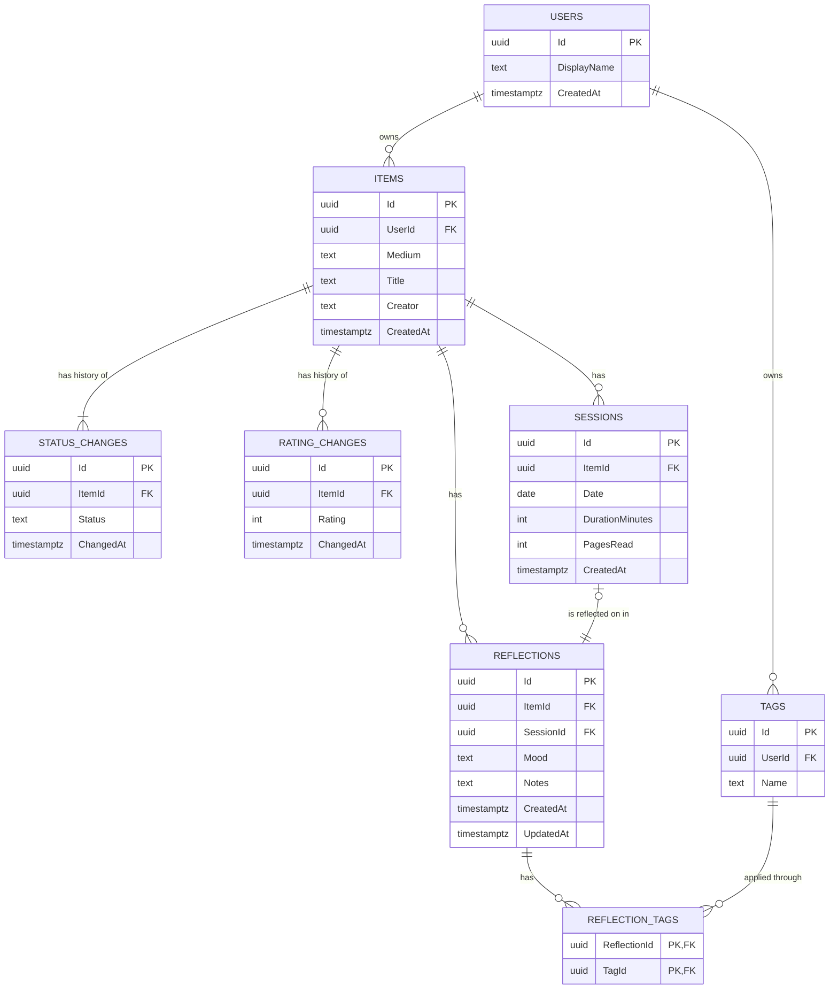

# Data model

Savepoint is a personal journal for books and games. Reflections are the heart of the app, so this model exists to preserve an item's timeline: what was thought, and when.

## Diagram

## Rules

| Table | Column | Rule |
|---|---|---|
| Items | `Medium` | `Book` or `Game` |
| Items | `Title` | 1 to 200 characters after trimming whitespace |
| Items | `Creator` | Optional; 1 to 200 characters after trimming, and saved as null when empty |
| StatusChanges | `Status` | `Backlog`, `InProgress`, `Finished` or `Dropped` |
| RatingChanges | `Rating` | Whole number from 1 to 10 |
| Sessions | `Date` | Not after today |
| Sessions | `DurationMinutes` | Greater than 0, and at most 1440 (24 hours) |
| Sessions | `PagesRead` | Optional, books only (enforced by the API) |
| Reflections | `SessionId` | Optional and unique, so a session has at most one reflection |
| Reflections | `Mood` | `Hooked`, `Delighted`, `Moved`, `Curious`, `Frustrated` or `Bored` |
| Reflections | `Notes` | At least 20 characters after trimming whitespace |
| Tags | `Name` | Unique per user |
| Users | `DisplayName` | 1 to 50 characters after trimming whitespace |

## Decisions

### Everyone's data is their own

Anyone who can reach the app can create an account, so each user's library is theirs alone. Items and Tags carry a `UserId`. Other tables reach their user through their item, because repeating `UserId` would allow the values to disagree.

### Accounts

People sign in with an email and a password, through ASP.NET Core Identity, which stores the email and the password's hash. How `Users` connects to Identity's tables is decided with the backend work.

- An email can have only one account. The API says when an email is already in use, and when no account uses one, because a vague message only frustrates people, and creating an account already reveals which emails are taken. Repeated sign-in attempts are limited instead.
- An email can be at most 256 characters, the size of Identity's column.
- A password must be 12 to 128 characters, with no other rules. Rules about uppercase letters, digits and symbols make passwords harder to remember without making them much stronger, so current guidance (NIST SP 800-63B) asks for length instead. Spaces count, and a password is never trimmed.
- There's no password reset by email yet, because the app runs locally without an email service.

### Every session has a reflection

Reflection is the reason the app exists, so logging a session requires one. A foreign key can't enforce this, so the API has a single endpoint that saves the session and its reflection in one transaction: both save, or neither does.

A reflection requires a mood and notes. Without a minimum length, a required reflection could still be empty, so notes must be at least 20 characters, which is about one short sentence.

### Reflections can stand alone

A reflection with no `SessionId` is a final thought or overall review. Because these still belong to an item, every reflection has an `ItemId`.

A session's reflection must belong to the same item as the session. A composite foreign key from `Reflections (SessionId, ItemId)` to `Sessions (Id, ItemId)` enforces this, and PostgreSQL skips the check when `SessionId` is null. It requires a unique constraint on `Sessions (Id, ItemId)`.

### Sessions are real days that have happened

A session can't be dated after today, and can't be longer than the 24 hours of the day it's logged on.

`Date` is the user's own calendar day, but the API runs in UTC, so its today can differ from the user's by up to a day either way. Until the app knows the user's time zone, the API allows dates up to one day after its own today. Rejecting a real session is worse than letting a slightly early one through.

### No reflection prompts

Prompts tailored to each medium were considered and dropped. Users reflect in their own words, which keeps the model and the experience simpler.

### Status and rating keep their history

A change of opinion is exactly what the timeline should show, so each change adds a row. An item's current status or rating is its newest row and is not also stored on `Items`, which avoids two sources of truth.

- An item gets its first `StatusChanges` row when it is created.
- An item has no `RatingChanges` rows until it is rated.

### Moods are a fixed list

A fixed list makes patterns visible across a timeline, which free text would not. Tags remain the free-form way to label reflections.

### Timeline order

Session reflections sort by the session's `Date`, so a session logged late still appears on the day it happened. Standalone reflections sort by `CreatedAt`.
